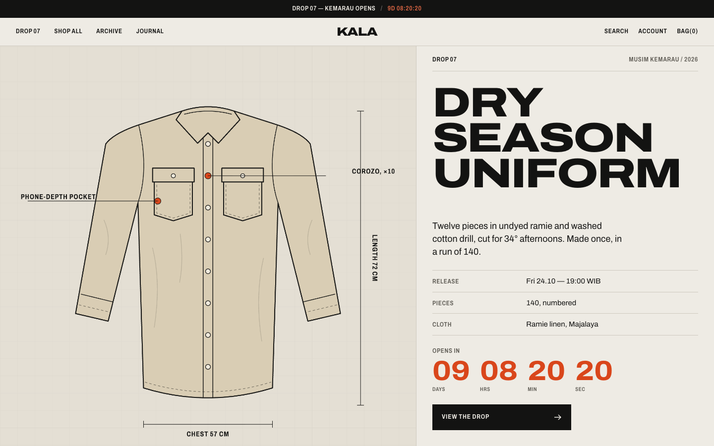
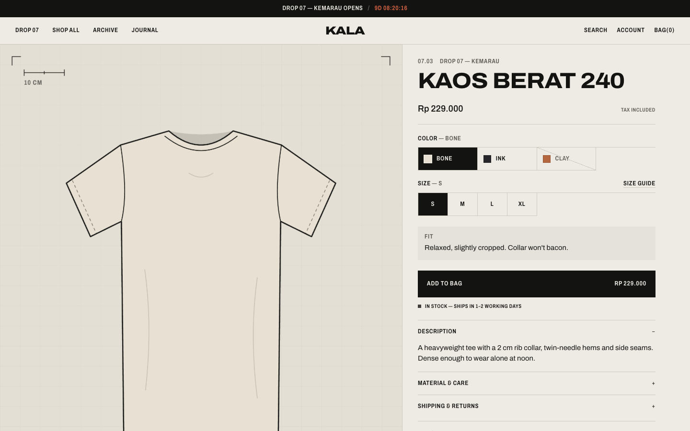
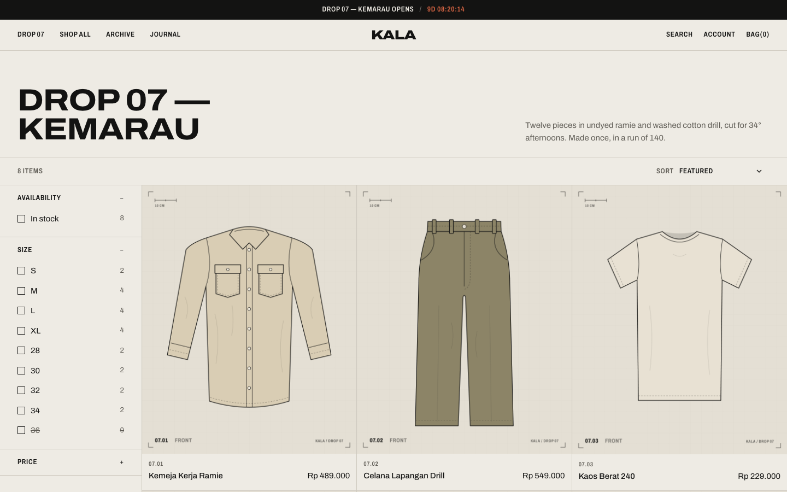
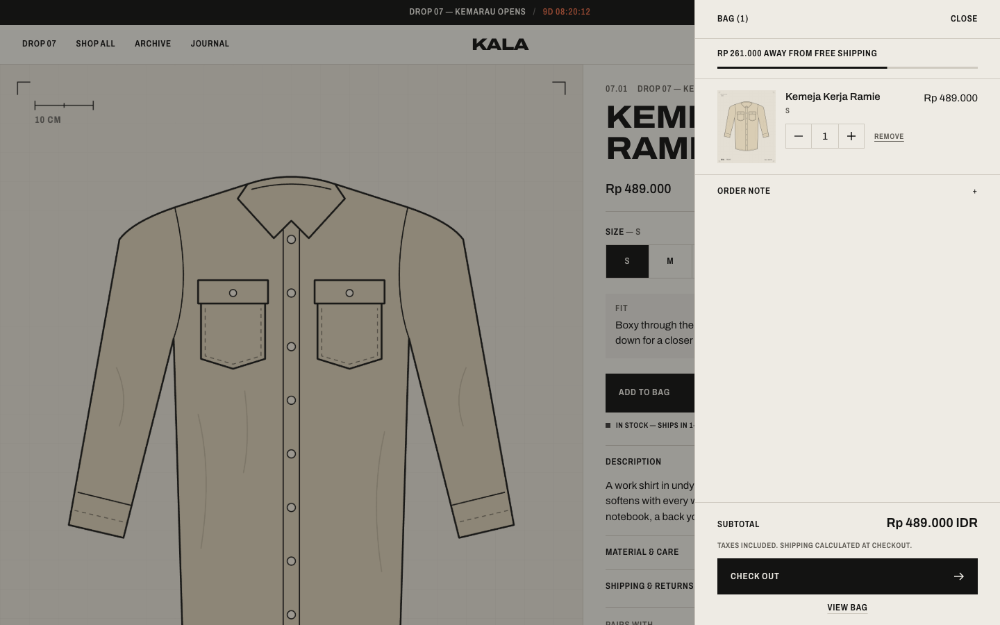
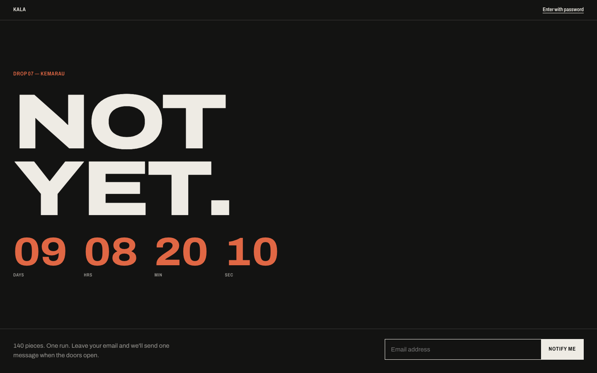
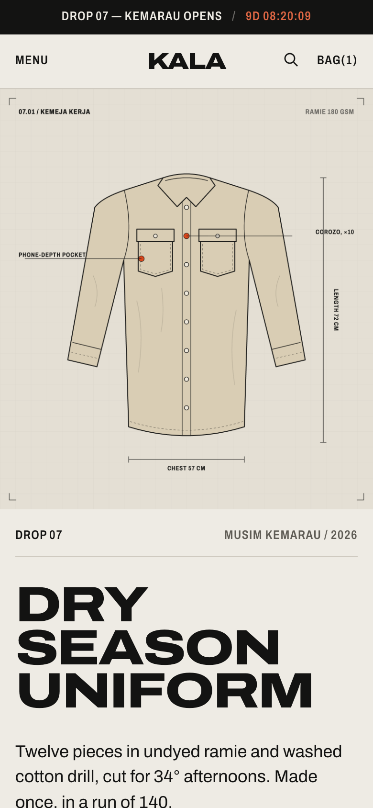
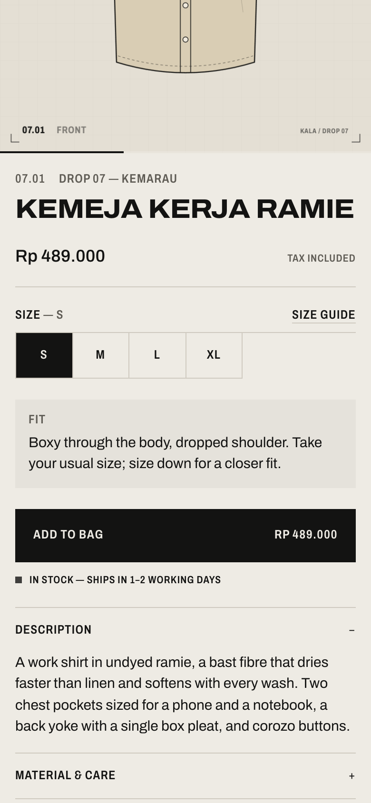
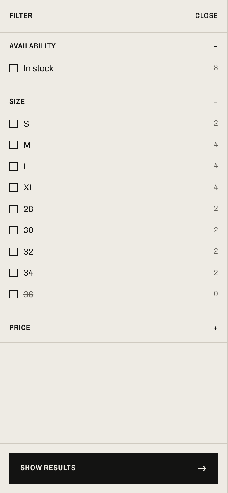

# Kala — Shopify store build

A complete Shopify build for **Kala**, a fictional Bandung apparel label that sells in numbered, limited *drops*. Every drop is a launch with a countdown, a small run, and a sell-out, which is exactly where a store's speed, tracking and integrations get stress-tested.

The repo has three parts:

| | What | Stack |
|---|---|---|
| [`theme/`](theme) | Custom Online Store 2.0 theme, built from scratch (not Dawn) | Liquid, CSS, vanilla JS (Web Components), no jQuery or frameworks |
| [`ops/`](ops) | Webhook receiver, back-in-stock via App Proxy, `store-doctor` CLI (app/script audit, Core Web Vitals, pre-launch checks), catalog seeding | Node 24, Hono, `node:sqlite`, Admin GraphQL API |
| [`pixel/`](pixel) | Consent-aware custom pixel for GA4 and Meta | Shopify Customer Events (Web Pixels API) |

Supporting folders: [`design/`](design) generates all product imagery as technical flats, [`preview/`](preview) renders the theme offline for development and end-to-end tests.

**▶ 90-second demo: [geffaa.github.io/kala-shopify](https://geffaa.github.io/kala-shopify/)**

**🛒 Try the store: [geffaa.github.io/kala-shopify/store/](https://geffaa.github.io/kala-shopify/store/)**: the real theme, rendered in your browser. Product pages, the cart drawer, filters and predictive search work; checkout is Shopify’s.

[](https://geffaa.github.io/kala-shopify/)

---

## How it maps to the role

### 1. Keeping the store healthy

**Diagnose and fix bugs.** The theme ships with a 13-step end-to-end suite ([`preview/e2e.mjs`](preview/e2e.mjs)) covering variant switching, sold-out states, restock signups, cart drawer quantity/remove, AJAX filtering, sorting, predictive search and quick add. It fails on any JS error or 404. Writing it surfaced real bugs, which were fixed. For example, the sticky add-to-bag bar didn't appear after a jump scroll, because IntersectionObserver doesn't fire when an element goes straight from "below the viewport" to "above the viewport". The fix (a stretched `rootMargin`) is commented in [`product.js`](theme/assets/product.js).

**Review installed apps and scripts.** `npm run doctor` ([`ops/src/doctor`](ops/src/doctor)) downloads the live theme through the Admin API and reports:
- third-party `<script src>` tags, flagging render-blocking ones in `<head>`
- legacy ScriptTags injected by apps
- enabled and disabled app embeds from `settings_data.json`
- tracking code pasted into the theme instead of Customer Events
- **orphan snippets** that nothing renders, typically left behind by uninstalled apps
- assets over 150 KB

**Check site speed and act on it.** The same command calls PageSpeed Insights and reports *field* data (CrUX p75: LCP, INP, CLS) separately from *lab* data, plus the LCP element and a per-third-party table of main-thread blocking time. That table is what tells you which app to remove.

**Keep analytics and ad tracking working.** [`pixel/kala-pixel.js`](pixel/kala-pixel.js) maps Shopify standard events to GA4 e-commerce events and Meta Pixel events. It covers checkout and the thank-you page, which themes can no longer reach. Consent comes from Shopify's Customer Privacy API through Google Consent Mode v2 and `fbq('consent')`. Purchases are de-duplicated by `transaction_id` (GA4) and `eventID` (for Meta CAPI). The theme also publishes its own events (`size_guide_opened`, `quick_add`, `filter_applied`, `back_in_stock_subscribed`) through `Shopify.analytics.publish`, so merchandising questions can be answered too.

### 2. Building and improving

**Theme sections and pages.** Every section is merchant-editable in the theme editor, with blocks, presets and section groups:

| Section | Notes |
|---|---|
| Drop hero | LCP-optimised: `fetchpriority=high` plus a preload header only when it's first on the page; the countdown hides itself server-side once the date passes |
| Featured collection | Hairline grid; cards with hover image, stock badges, colour swatches, size quick-add |
| Lookbook | Shoppable hotspots; the box takes the image's own ratio so pins stay exact at every width |
| Production notes | Editorial spec-sheet block |
| Drop archive | Status (Available / Sold out) derived from inventory, not a setting someone forgets to update |
| Product | Variant picker, size guide from a JSON metafield, back-in-stock, low-stock copy, "pairs with" product references, sticky add-to-bag, `@app` blocks, structured data |
| Collection / search | Storefront filtering and sorting without page loads, shareable URLs, load more, mobile drawer that becomes a desktop sidebar |
| Cart drawer + page | One round trip per mutation, using the Section Rendering API `sections` param; free-shipping meter that hides itself when the customer browses in another currency |
| Password page | Drop teaser with countdown and signup; on a dev store, this is the first thing a reviewer sees |

**Connect Shopify with third parties.** [`ops/`](ops) is a small, production-shaped integration service:
- **Webhooks** (`orders/create`, `products/update`, `inventory_levels/update`, `app/uninstalled` and the three mandatory privacy topics) are declared in [`shopify.app.toml`](ops/shopify.app.toml). They are verified by HMAC on the raw body, de-duplicated by `X-Shopify-Webhook-Id`, acknowledged immediately, then processed on a retrying queue.
- **Order → 3PL**: orders are trimmed to what the warehouse needs, signed, and sent with an `Idempotency-Key`. The order is then tagged `3pl-synced` through the Admin API.
- **Back-in-stock** uses an **App Proxy** (`/apps/kala/back-in-stock`), so the theme posts same-origin with a signed request and no CORS. When `inventory_levels/update` reports stock, subscribers get one email each, capped so more people than units aren't notified.
- **Low-stock alerts** go to Slack during a drop.
- **Auth** uses the client credentials grant for Dev Dashboard apps; the ~24h tokens are cached and refreshed. A cost-aware GraphQL client waits exactly as long as the throttle bucket needs.

**Organise the theme for a smooth end-to-end UX.** Liquid stays the source of truth: JS never re-implements money formatting or inventory copy, it swaps in server-rendered HTML. The theme is translated in English and Bahasa Indonesia.

### 3. Supporting campaigns

**Get the site technically ready before a launch.** `npm run launch-check -- --collection drop-07-kemarau --at 2026-10-24T19:00:00+07:00 --discount DROP07` runs a pre-launch checklist and exits non-zero on failures, so it can gate a deploy:

```
FAIL  oversell    Jaket Kebun            M: "continue selling when out of stock" is on.
FAIL  compare-at  Tas Sisa Kain          Default Title: compare-at 149000 is not above price 149000 — strikethrough would be misleading.
FAIL  discount    DROP07                 Starts 2026-10-25T00:00:00Z, after launch.
WARN  size-chart  Kaos Berat 240         Has a Size option but no kala.size_chart metafield.
WARN  status      Topi Lapangan          Status is DRAFT. Activate before launch.
WARN  alt-text    Celana Pendek Drill    2 image(s) without alt text.

NOT READY — 3 failure(s), 3 warning(s)
```

Above: real output from the rules run against the Drop 07 catalog, with five typical misconfigurations injected. It checks status, Online Store publication, price sanity, oversell policy, inventory tracking, stock at launch, shipping weight, image count, alt text, SEO description, size charts, and whether discount codes are live at the launch moment.

**Campaign UI.** Countdowns in the announcement bar, hero and password page all switch to their "live" text on their own when time runs out, both client-side and on the next server render.

---

## Performance & accessibility

Lighthouse, mobile (simulated throttling), on the offline preview:

| Page | Performance | Accessibility | Best practices | SEO | CLS | TBT |
|---|---|---|---|---|---|---|
| Home | 92 | 100 | 100 | 100 | 0 | 0 ms |
| Collection | 89 | 100 | 100 | 100 | 0 | 0 ms |
| Product (shirt) | 94 | 100 | 100 | 100 | 0 | 0 ms |
| Product (tee) | 95 | 100 | 100 | 100 | 0 | 0 ms |

LCP in the preview is 2.9–3.8 s, which is pessimistic. The preview serves full-size PNGs for every `?width=`, while Shopify's CDN resizes and serves WebP/AVIF. Budgets are enforced in CI ([`lighthouserc.json`](lighthouserc.json)).

How:
- **One font file.** Archivo variable (weight and width axes, Latin subset, 90 KB) replaces 4–6 static files. It's preloaded with `preload_tag`, and a metric-matched Arial fallback (`size-adjust`, `ascent-override`) means the font swap moves nothing.
- **No render-blocking JS.** Modules only. Page-specific code (`product.js`, `facets.js`) loads only on those templates, and section CSS is inlined only where the section is used. Home page: one CSS request, one JS request.
- **Images.** `image_url` + `image_tag` with `srcset`/`sizes` per layout, explicit dimensions, `aspect-ratio` boxes, and lazy loading everywhere except the LCP candidate.
- **Accessibility.** Native `<dialog>` for every drawer and modal (focus trap and Escape for free, focus returned to the opener), radio groups for variants, live regions for cart and filter updates, visible focus, `prefers-reduced-motion`, and signal colours tuned per use to keep 4.5:1 contrast.

---

## Design

The brief I set: *anti-template*. No rounded cards, gradients, drop shadows or icon soup. The store should look like a garment tech pack:

- Bone paper, ink, and one **signal** colour reserved for time-sensitive information (countdowns, low stock, sale prices).
- Hairline grids instead of cards; numbered sections (`01`, `02` …); spec tables instead of marketing copy.
- One typeface: Archivo set ultra-wide for display and condensed for labels.
- **Product imagery is generated.** [`design/garments.mjs`](design/garments.mjs) draws every garment as an SVG technical flat (topstitching, folds, callouts, dimensions) and renders 40 PNGs through headless Chrome. It's consistent across products, cheap to extend, and there's nothing to license.

| | |
|---|---|
|  |  |
|  |  |

<p>
  
  
  
</p>

---

## The live store demo

`docs/store/` is the offline preview, running in the visitor's browser instead of on a server.
`npm run web` bundles `preview/server.mjs` unchanged into a Service Worker with esbuild: Node's
`fs`, `http` and `path` are swapped for small shims, the theme and catalog are embedded, and
liquidjs reads them from memory. The worker answers every request under the store's path (pages,
the Ajax Cart API, Section Rendering, search), re-basing URLs for GitHub Pages. Cart requests are
replayed when the browser restarts an idle worker, so the bag survives, and a small cookie jar
stands in for `Set-Cookie`, which synthetic responses can't carry.

It passes the same 13 end-to-end checks as the Node preview:

```bash
npm run web && (cd docs && python3 -m http.server 8000) &
WARMUP=1 BASE=http://localhost:8000/store npm run e2e
```

A development store remains the source of truth; this is for anyone who wants to click through
without a store password.

## Running it

```bash
npm install && npm --prefix ops install

# Offline preview (no store needed): renders the theme with the seed catalog
npm run preview          # http://localhost:9393
npm run e2e              # 13 interaction checks
npm test                 # Theme Check + 23 ops unit/integration tests

# Against a development store
npm run theme:dev        # shopify theme dev, with hot reload
cp ops/.env.example ops/.env   # fill SHOPIFY_SHOP, client id/secret
npm --prefix ops run seed      # metafield definitions, 11 products, 3 collections, images
npm --prefix ops start         # webhooks + app proxy on :8787
npm --prefix ops run doctor -- --url https://your-store.com
```

To set up a store: create a development store in the Shopify Partner dashboard, then create an app in the Dev Dashboard with the scopes from [`shopify.app.toml`](ops/shopify.app.toml). Install it on the store and copy the client ID and secret into `ops/.env`. Paste [`pixel/kala-pixel.js`](pixel/kala-pixel.js) into *Settings → Customer events*, using your own GA4 and Meta IDs.

## Repo map

```
theme/      2 layouts · 21 sections · 10 snippets · 11 templates · en + id locales
ops/        src/app.js (HTTP) · webhooks/ · doctor/ (audit, PSI, launch rules) · seed/ · test/
pixel/      kala-pixel.js
design/     garments.mjs (SVG flats) · build.mjs (renderer) · out/ (40 PNGs)
preview/    server.mjs (liquidjs + Shopify tags/filters + Ajax Cart/Section Rendering emulation) · e2e.mjs
```

The preview approximates Shopify's runtime for fast iteration. A development store is the source of truth.
